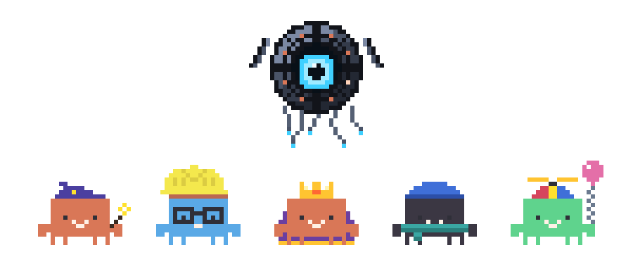

<p align="center">
  
</p>

<h1 align="center">Claude Buddy</h1>

<p align="center">
  <b>A pixel companion for every Claude Code session, living on your desktop.</b><br>
  It acts out what Claude is doing, taps you on the shoulder when Claude needs you, and is far too dramatic about usage limits.
</p>

<p align="center">
  Windows · macOS · Linux &nbsp;|&nbsp; Claude Code in any terminal, VS Code-family IDE, JetBrains IDE or the Claude app
</p>

---

Type `/buddy` in a Claude Code session and a little pixel creature gets built on your desktop. From then on it **is** that session: it reads when Claude reads, tests when Claude tests, paces when Claude thinks, and comes looking for you when Claude needs permission or has a question. Run five sessions and you get five buddies, each with its own name, hat and personality, roaming your screens, climbing your windows and occasionally saying hi to each other.

> Claude Buddy is an unofficial fan project. It is not made by, affiliated with or endorsed by Anthropic. "Claude" is a trademark of Anthropic.

## Highlights

- **One buddy per session.** Every Claude Code session you summon one for gets its own buddy, and helper buddies show up for sub-agents.
- **It shows what Claude is doing.** Dozens of animations for reading, searching, coding, testing, building, deploying, thinking and more. Hover a buddy to see the current step, Claude's latest thought and how full the context window is. (We won't spoil the rest.)
- **It gets your attention for the right things.** A `!` for permission prompts, a `?` for questions, a `✓` when Claude is done. You can answer permission prompts with **Allow / Always / Deny** buttons right on the buddy.
- **Click it to jump back.** Clicking a buddy brings its session to the front: the right terminal, IDE window or Claude app conversation.
- **Feed it files.** Drag files onto a buddy and it eats them, and they land in that session's prompt box.
- **The Overlord.** A watchful eye in the corner of your screen that builds new buddies. Hover it for your **session and weekly usage limits** and today's numbers; click it and it comes out of its corner with everything it can do: inspection patrols, a holo-report of your day, drones, the weather, and a boss fight your buddies can win (with your help). It has opinions about usage limits, and about most other things.
- **The skyscraper.** Every buddy gets its own floor in a little tower at the bottom-left of your screen. The window lights up when it's home; flip the switch next to it to send it to work (or call it home). It takes the elevator, of course. Pop the tower up when you want it and tuck it into the ground when you don't.
- **A life between jobs.** Idle buddies go looking for each other and chat in speech bubbles about what they're working on. Play fetch (they never give up on the ball), wake a sleepy one with a little shake… just don't overdo the shaking.
- **Make it yours.** An RPG-style Buddy Workshop with 46 hats, wands, umbrellas, capes, jetpacks, colours and more, plus a room in the skyscraper to furnish however you like. Names, looks and settings are remembered per session.
- **Polite.** Stays out of the way of fullscreen apps (unless something important happens), never sends anything anywhere except the usage check you'd expect, and costs no tokens: `/buddy` commands never reach the model.

## Quick start

You need **Claude Code** and **[Node.js 18+](https://nodejs.org)** (the plugin's hooks run on Node).

**1. In Claude Code, add the plugin** (any session, any surface):

```
/plugin marketplace add sideswipeishacking/claude-buddy
/plugin install claude-buddy@claude-buddy
```

**2. Activate it and summon your buddy** (in a session that was already open, run `/reload-plugins` first; new sessions load it by themselves):

```
/reload-plugins
/claude-buddy:buddy
```

The first time, Claude Buddy sets itself up in the background (it downloads its desktop app, about 100 MB, a minute or two) and then builds your buddy. After that, plain `/buddy` works everywhere.

Prefer the terminal? One command installs the app and the plugin:

```bash
npx github:sideswipeishacking/claude-buddy
```

More options (cloning, updating, uninstalling, per-OS notes) are in the **[installation guide](docs/installation.md)**.

## Where it works

| Claude Code running in… | Supported |
| --- | --- |
| Any terminal (Windows Terminal, PowerShell, macOS Terminal, iTerm2, WezTerm, Ghostty, kitty, Alacritty, GNOME Terminal, Konsole, …) | ✅ |
| VS Code-family IDEs with the Claude Code extension (VS Code, Cursor, Windsurf, Antigravity, VSCodium, …) | ✅ |
| JetBrains IDEs (Claude Code in the IDE's terminal) | ✅ |
| The Claude desktop app (Windows, macOS) | ✅ |
| claude.ai in a web browser | ❌ not supported |

| Feature | Windows | macOS | Linux |
| --- | :---: | :---: | :---: |
| Buddies, animations, the Overlord, the Workshop | ✅ | ✅ | ✅ |
| Walking on your windows' title bars | ✅ | ✅ | ✅ (X11 / XWayland apps) |
| Click a buddy to jump to its session | ✅ | ✅ | ✅ |
| Allow / Always / Deny on the buddy | ✅ | ✅ | ✅ |
| Usage limits on the Overlord | ✅ | ✅ | ✅ |
| Buddy types along while you type | ✅ | ✅ opt-in | ✅ |
| Drop files on a buddy → into the prompt box | ✅ | ✅ needs Accessibility | ✅ |
| Feeding files to it from the "Open" dialog | ✅ | — | — |

Windows is the most battle-tested platform; macOS and Linux support is new, so reports are very welcome. See **[platform notes](docs/platforms.md)** for permissions and details.

## Documentation

| Guide | What's in it |
| --- | --- |
| [Installation](docs/installation.md) | Every way to install, update and uninstall, per operating system |
| [Getting started](docs/getting-started.md) | A tour: your first buddy, the Overlord, the skyscraper, the Workshop, permissions, files |
| [Commands](docs/commands.md) | `/buddy …` reference, the menus, the `claude-buddy` CLI |
| [Tips & tricks](docs/tips.md) | Small things that make it nicer to live with |
| [Platforms](docs/platforms.md) | What works where, and the permissions macOS and Linux need |
| [Troubleshooting](docs/troubleshooting.md) | When a buddy doesn't show up, and other fixes |
| [Privacy](docs/privacy.md) | Exactly what it reads, what it keeps, and the one network call it makes |
| [Development](docs/development.md) | How it works inside, running from source, tests |

## Privacy in one paragraph

Everything stays on your computer. The plugin's hooks talk only to the desktop app on `127.0.0.1`. The only network request is the usage check the Overlord makes to `api.anthropic.com`, using the login Claude Code already has (the same request Claude Code's own `/usage` makes). The keyboard watcher behind "type along" only learns *that* a key was pressed, never which one. No analytics, no telemetry. Details in [docs/privacy.md](docs/privacy.md).

## Uninstall

```bash
npx github:sideswipeishacking/claude-buddy uninstall
```

(or `/plugin uninstall claude-buddy@claude-buddy` and the [manual steps](docs/installation.md#uninstalling)).

## Contributing

Bug reports, platform reports (especially macOS and Linux), new hats and animations are all welcome. See [CONTRIBUTING.md](CONTRIBUTING.md).

## License

[MIT](LICENSE) © sideswipeishacking
